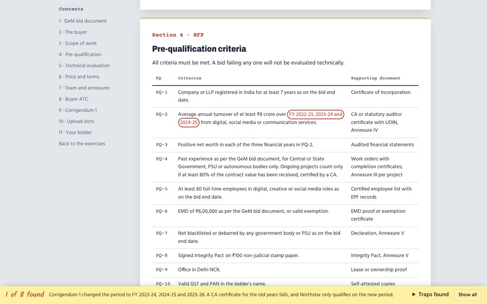

<div align="center">
  <h1>Tender Training</h1>
  <p><strong>Winning on GeM: a hands-on training deck for the Avian WE bid team.</strong></p>
  <p><a href="docs/facilitator-guide.md">Facilitator guide</a> · <a href="docs/editing-content.md">Editing the content</a> · <a href="practice/tender.html">Practice tender</a></p>
</div>


## What it is

A slide deck that runs in the browser and walks a new bid team member through a Government e-Marketplace (GeM) tender, from finding the bid to the submission receipt. It is built from the way our team ran its 2026 bids, with client names, money and people's details taken out.

Nearly every page asks the room to do something:

| Chapter | What trainees do |
| --- | --- |
| Platforms | Pick the right portal for six real-world tenders; flip index cards of GeM terms |
| Scouting | Search sample bids and build a pipeline; triage a bilingual bid document against a five-minute clock |
| Scope with Claude | Catch the planted mistake in Claude's answer and open its source; copy tested prompts; put documents in order of authority |
| Eligibility | Match criteria to evidence; test the 3 × 40%, 2 × 50%, 1 × 80% experience rule |
| Bid or no-bid | Fill a decision note that stamps itself; red-pen risky commercial clauses |
| Scoring | Move QCBS sliders and see what the runner-up would need; fill a marks sheet |
| Documents | Circle seven mistakes in a draft bid letter; open the evergreen vault |
| Teams | Sort documents to their owners; plan back from a deadline; run a live tracker |
| Submitting | Submit the practice bid in a simulator of the five participation tabs; explore real, redacted GeM screenshots |
| File limits | Estimate scanned PDF sizes; decide which mistakes cause rejection |
| Practice | Hunt eight traps in a full fictional tender, then work six exercises |
| Quiz | A two-team quiz with a scoreboard |

<table>
  <tr>
    <td></td>
    <td></td>
  </tr>
  <tr>
    <td></td>
    <td></td>
  </tr>
</table>

## Running it

Open `index.html` in a browser. No build step and no internet needed apart from web fonts.

To serve it locally (needed for the tests, handy for sharing on a network):

```sh
npm install
npm start          # http://localhost:4173
```

| Key | Action |
| --- | --- |
| `→` `Space` / `←` | Next / previous slide |
| `O` | Every slide at a glance |
| `N` | Trainer's notes |
| `F` | Full screen |
| `T` | Light or dark |

Every slide has its own address, for example `index.html#gem-sim`.

## Project layout

```
index.html              the deck: one <section class="slide"> per slide
practice/tender.html    the fictional practice tender with its trap hunt
assets/css/             deck.css (tokens, layout), widgets.css, tender.css
assets/js/core.js       helpers and the widget registry
assets/js/deck.js       navigation, notes, overview, theme
assets/js/widgets/      games, red pen, tools, Claude simulator, GeM simulator
assets/img/gem/         redacted GeM screenshots
docs/                   facilitator guide, editing guide, README screenshots
tests/                  Playwright checks for every slide and widget
scripts/serve.mjs       zero-dependency static server
```

## Checks

```sh
npm run lint       # ESLint
npm test           # Playwright: every slide, phone and desktop, plus each game
```

CI runs both on every push and pull request. See [CONTRIBUTING.md](CONTRIBUTING.md).

## Publishing

`.github/workflows/pages.yml` publishes the site to GitHub Pages on every push to `main`. Turn it on once under **Settings → Pages → Source: GitHub Actions**.

## Privacy

This repository is public. It holds no client financials, bank details, quoted prices, real bid numbers or personal data. The screenshots come from the GeM seller view with the account name removed. The practice tender, its buyer and its bidder are fictional.

## License

[MIT](LICENSE) © 2026 Bireshwar Chakravarty
