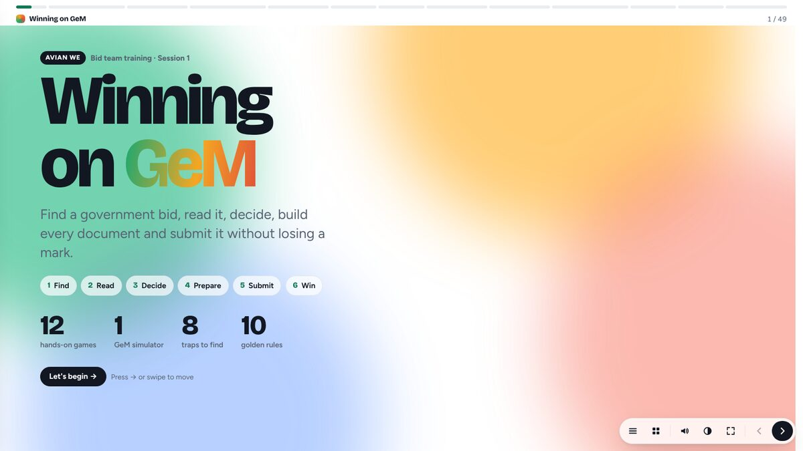
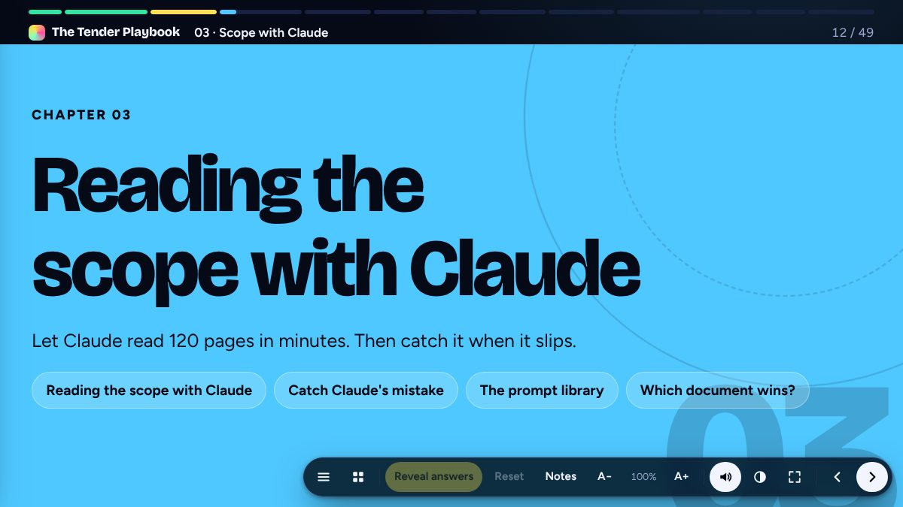
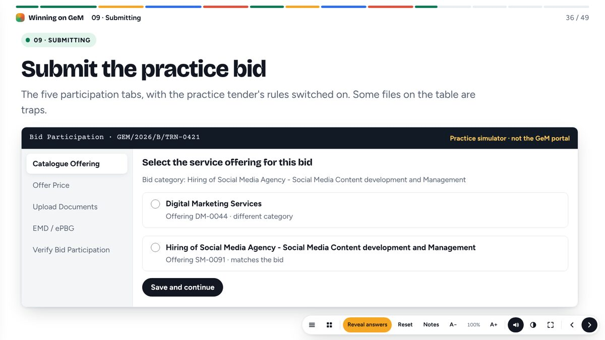
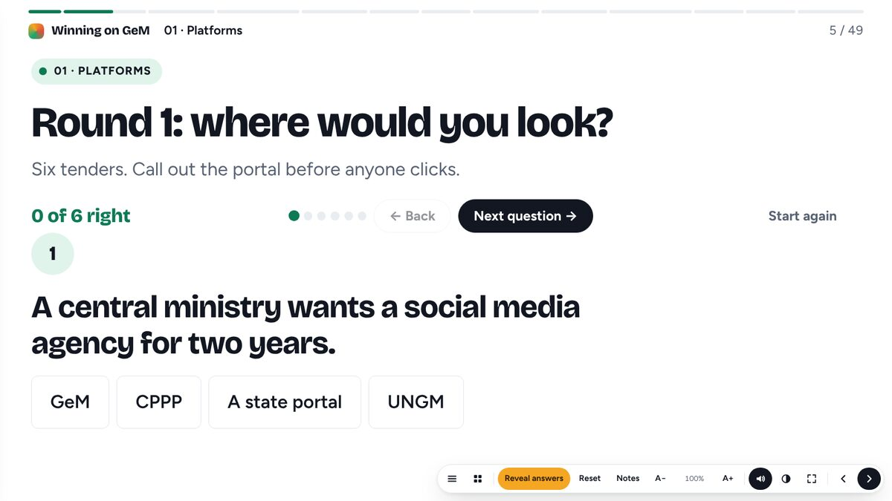
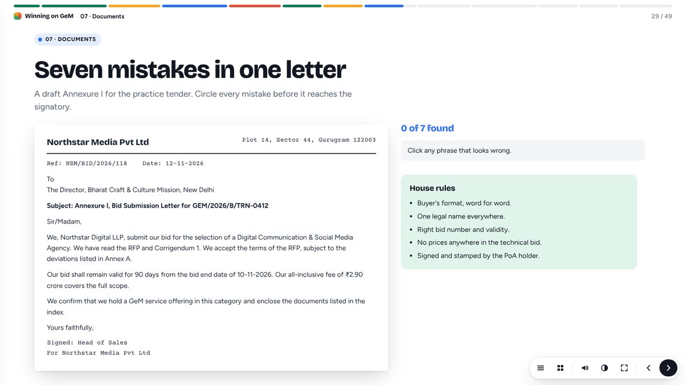
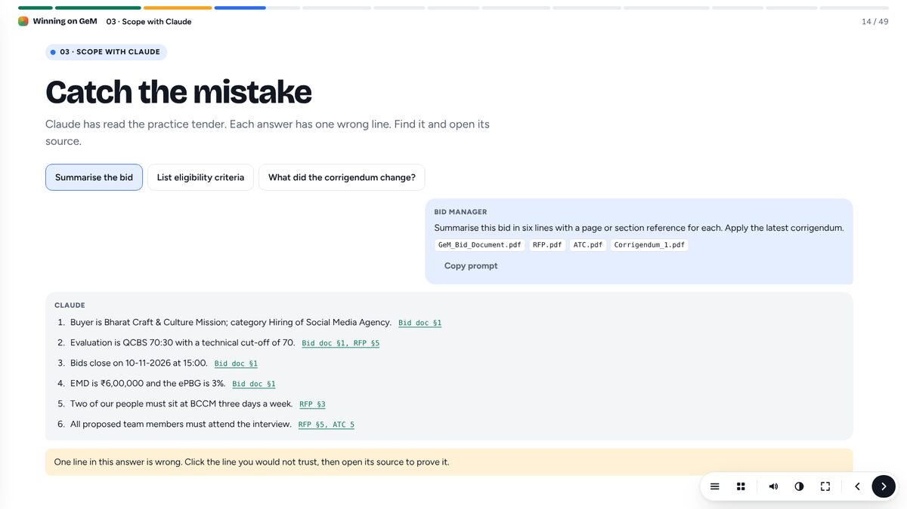

<div align="center">
  <h1>Tender Training</h1>
  <p><strong>Winning on GeM: a hands-on, animated training deck for the Avian We bid team.</strong></p>
  <p>
    <a href="https://bireshwarchakravarty.github.io/TenderTraining/present/"><strong>Presenter link</strong></a> ·
    <a href="https://bireshwarchakravarty.github.io/TenderTraining/"><strong>Attendee link</strong></a> ·
    <a href="docs/facilitator-guide.md">Facilitator guide</a> ·
    <a href="docs/editing-content.md">Editing the content</a>
  </p>
</div>



## Two links

| Link | Who it's for | What changes |
| --- | --- | --- |
| [`/TenderTraining/present/`](https://bireshwarchakravarty.github.io/TenderTraining/present/) | The trainer, on the projector | Type sized for a big screen, a QR code for attendees, **Reveal answers** and **Reset** on every activity, trainer's notes, laser pointer, blank screen, text size, sound on |
| [`/TenderTraining/`](https://bireshwarchakravarty.github.io/TenderTraining/) | Attendees, on phones and laptops | Normal size, play every activity, answers stay hidden until the trainer reveals them, sound off |

## What's inside

Twelve chapters, each opened by a full-colour divider, from finding a bid to the submission receipt, ending on a thank-you slide with fireworks.

| Chapter | What trainees do |
| --- | --- |
| Platforms | Pick the right portal for six tenders; flip index cards of GeM terms |
| Scouting | Search sample bids and build a pipeline; triage a bilingual bid document against a five-minute clock |
| Scope with Claude | Catch the planted mistake in Claude's answer; copy tested prompts; rank documents by authority |
| Eligibility | Match criteria to evidence; test the 3 × 40%, 2 × 50%, 1 × 80% experience rule |
| Bid or no-bid | Fill a decision note that stamps itself; red-pen risky commercial clauses |
| Scoring | Move QCBS sliders and see what the runner-up needs; fill a marks sheet |
| Documents | Circle seven mistakes in a bid letter; open the evergreen vault |
| Teams | Sort documents to owners; plan back from a deadline; run a live tracker |
| Submitting | Submit the practice bid in a five-tab simulator; explore real, redacted GeM screenshots |
| File limits | Estimate scanned PDF sizes; decide which mistakes cause rejection |
| Practice | Hunt eight traps in a fictional tender, then six exercises |
| Quiz | Two teams, nine questions, a scoreboard and confetti |

<table>
  <tr>
    <td></td>
    <td></td>
  </tr>
  <tr>
    <td></td>
    <td></td>
  </tr>
  <tr>
    <td></td>
    <td></td>
  </tr>
</table>

## Presenting

| Key | Action |
| --- | --- |
| `→` `Space` / `←` | Next / previous slide |
| `R` | Reveal the answers on this slide (presenter) |
| `L` | Laser pointer (presenter) |
| `B` | Blank the screen (presenter) |
| `+` / `−` | Bigger or smaller text (presenter) |
| `N` | Trainer's notes (presenter) |
| `O` | Every slide at a glance |
| `S` | Sound effects on or off |
| `F` | Full screen |
| `T` | Light or dark |

Every slide has its own address, for example `/present/#gem-sim`. Motion and effects switch off automatically for anyone whose device asks for reduced motion.

## Running it locally

```sh
npm install
npm start          # http://localhost:4173  and  http://localhost:4173/present/
```

Opening `index.html` straight from disk also works.

## Project layout

```
index.html              the deck: one <section class="slide"> per slide
present/index.html      the presenter link (opens the deck in presenter mode)
practice/tender.html    the fictional practice tender with its trap hunt
assets/css/             deck.css (design tokens, layout, motion), widgets.css, tender.css
assets/js/core.js       helpers, the two views, the widget registry, reveal and reset
assets/js/fx.js         confetti, fireworks, sounds, count-ups, laser, blackout
assets/js/deck.js       navigation, chapter bar, presenter fit-to-screen, keys
assets/js/widgets/      games, red pen, tools, Claude simulator, GeM simulator
assets/img/             redacted GeM screenshots and the attendee QR code
docs/                   facilitator guide, editing guide, README screenshots
tests/                  Playwright checks for both views and every activity
scripts/serve.mjs       zero-dependency static server
```

## Checks

```sh
npm run lint       # ESLint
npm test           # Playwright: every slide on desktop, phone and a 1080p projector, plus each activity
```

CI runs both on every push and pull request. See [CONTRIBUTING.md](CONTRIBUTING.md).

## Publishing

On every push to `main`, `.github/workflows/pages.yml` deploys the site to GitHub Pages (Settings → Pages → Source: GitHub Actions).

## Privacy

This repository is public. It holds no client financials, bank details, quoted prices, real bid numbers or personal data. The screenshots come from the GeM seller view with the account name removed. The practice tender and its buyer are fictional. The bidder is Avian We at its public office address, but its practice profile (turnover, projects, staff) is made up.

## License

[MIT](LICENSE) © 2026 Bireshwar Chakravarty
